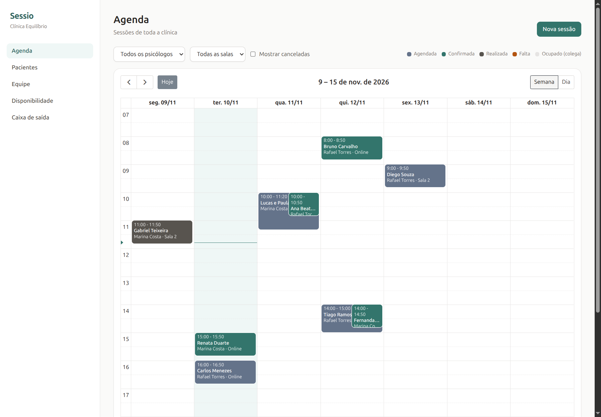
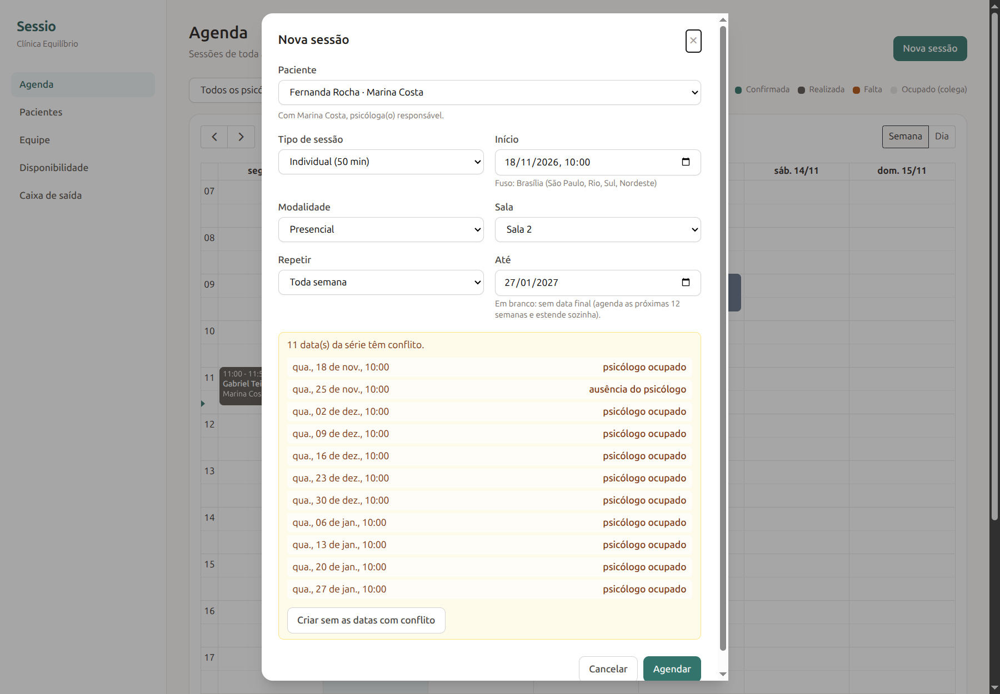
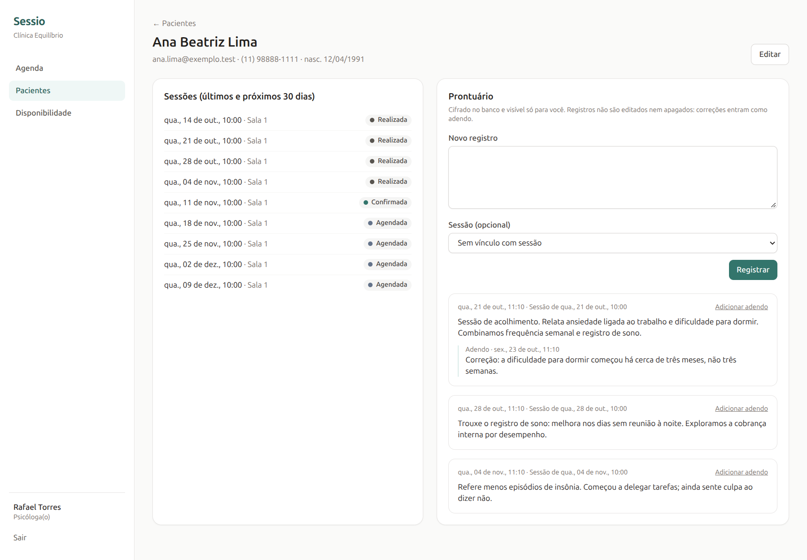
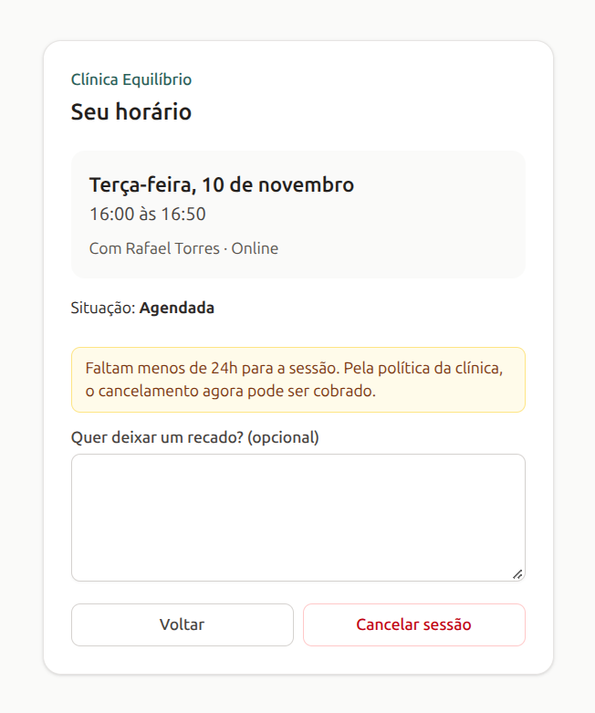
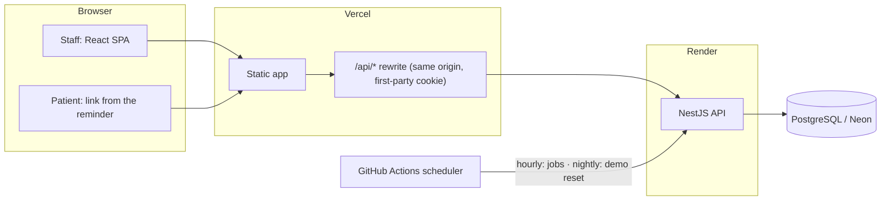

# Sessio

Scheduling for psychology practices: a shared calendar for a clinic's psychologists and rooms, weekly recurring sessions, automatic reminders with a confirm/cancel link for the patient, and confidential clinical notes.

The interface is in Brazilian Portuguese (the product is for Brazilian clinics); code and docs are in English.

**Live demo:** _coming soon_. Sign in with one click as the owner, the receptionist or one of the two psychologists. The data is fictional and resets every night.



## What it does

| | |
|---|---|
| **Multi-user clinic** | Owner, reception and psychologists, invited by e-mail. Deny-by-default authorization: each role sees what it needs and nothing more. |
| **Calendar** | Week and day views in the clinic's timezone, filters by psychologist and room, working hours shaded, drag to reschedule. A psychologist sees colleagues' sessions only as "busy". |
| **Rules that hold** | No overlap per psychologist, room or patient (counting the buffer between sessions), only inside working hours and outside time off. Enforced by PostgreSQL, not just checked. |
| **Recurring sessions** | Weekly or every two weeks, materialized 12 weeks ahead and extended by a job. Every conflicting date is reported at once. Edit or cancel "only this one" or "this and the following". |
| **Lifecycle** | `scheduled → confirmed → completed / no-show`, or cancelled. A patient cancelling within the clinic's deadline (24 h by default) becomes a chargeable late cancellation. Nothing is confirmed or cancelled after the session has started. |
| **Reminders** | Sent ahead of each session (48 h by default) with a signed link where the patient confirms or cancels, no account needed. Rescheduling sends a new one; old links stop working. |
| **Clinical notes** | Readable by the author only, not even the clinic's owner. AES-256-GCM bound to each row, append-only with addenda, every access audited (denials included). |

| Series with conflicts | Clinical record | Patient's link |
|---|---|---|
|  |  |  |

## Architecture



- **API** (`apps/api`): NestJS 12, Drizzle ORM, PostgreSQL 16. Modules per domain: auth, staff, patients, rooms, session types, availability, appointments (single and series), notifications (outbox, reminders, signed links), public patient page, notes, audit, jobs, demo.
- **Web** (`apps/web`): React 19, Vite, TanStack Query, React Router, FullCalendar (MIT plugins) with Luxon for the clinic's timezone, Tailwind CSS. The calendar route is lazy-loaded.
- **E-mail**: a transactional outbox in PostgreSQL. Messages are written in the same transaction as the change that causes them, then published with retries. Transports: SMTP (Mailpit in development), Resend, or log-only.
- **Periodic work** (series horizon, reminders, outbox drain): in-process every 5 minutes while the API is awake, and hourly from GitHub Actions, since free hosting sleeps. Every step is idempotent.

## Design decisions

Each one is an ADR in [`docs/adr`](docs/adr):

1. [Overlaps are refused by the database, not only by the API](docs/adr/0001-overlaps-enforced-by-the-database.md) (exclusion constraints).
2. [Recurring sessions are materialized up to a rolling horizon](docs/adr/0002-weekly-series-materialized-with-a-horizon.md).
3. [Server-side sessions in a cookie, not JWTs](docs/adr/0003-server-sessions-instead-of-jwt.md).
4. [Reminders through a transactional outbox, triggered by an external scheduler](docs/adr/0004-reminders-outbox-and-external-scheduler.md).
5. [Patient links are signed and bound to the session's start time](docs/adr/0005-patient-links-signed-and-bound-to-the-start-time.md).
6. [Clinical notes: author only, encrypted, append-only, audited](docs/adr/0006-clinical-notes-author-only-and-encrypted.md).
7. [Drizzle ORM, with hand-written SQL where the rules live](docs/adr/0007-drizzle-and-hand-written-sql.md).
8. [A public demo that resets itself every night](docs/adr/0008-public-demo.md).

## Tests

28 unit tests (pure rules: lifecycle, timezone math, series dates, cipher) and 112 end-to-end tests against a **real PostgreSQL** started by Testcontainers, because exclusion constraints and row locks don't exist in mocks. Among them:

- 20 simultaneous bookings of one slot: exactly one wins, and the database refuses an overlap even when the API is bypassed.
- Psychologist, room and patient conflicts, including the buffer; working hours and time off; invalid transitions; late cancellation.
- A series with conflicts is refused whole, listing every conflicting date and why; horizon extension stays idempotent under concurrent runs.
- Reminders: one per session even with concurrent job runs, none for cancelled sessions; a rescheduled session gets a new one and its old link stops working (410); forged or tampered links are a 404.
- Notes: owner and reception get 403, a colleague gets 404, both attempts audited; a tampered or copied ciphertext is never served.
- IDOR: another clinic's staff, patients, rooms, sessions and notes are always a 404.

```bash
pnpm --filter @sessio/api test       # unit
pnpm --filter @sessio/api test:e2e   # end to end (needs Docker)
```

CI runs lint, typecheck, both suites, the web build and the Docker image build on every push.

## Running locally

Requires Node 22, pnpm (via `corepack enable`) and Docker.

```bash
docker compose up -d                          # PostgreSQL on :5434, Mailpit on :8025
cp apps/api/.env.example apps/api/.env
pnpm install
pnpm --filter @sessio/api db:migrate
pnpm --filter @sessio/api dev                 # API on http://localhost:3100/api
pnpm --filter @sessio/web dev                 # web on http://localhost:5173
```

Create a clinic from the sign-up page. Invitations and reminders land in Mailpit (http://localhost:8025). To load the demo clinic instead (this wipes the local database):

```bash
pnpm --filter @sessio/api demo:reset          # needs a build: run it while `dev` is running
echo VITE_DEMO_MODE=true > apps/web/.env.local
```

Demo accounts: `helena@equilibrio.test` (owner), `julia@equilibrio.test` (reception), `rafael@equilibrio.test` and `marina@equilibrio.test` (psychologists), password `sessio-demo-2026`.

## Deployment (free tiers)

| Piece | Where | Notes |
|---|---|---|
| API | Render, Docker ([`render.yaml`](render.yaml)) | Runs migrations, then starts. Refuses to boot in production with development secrets. |
| Web | Vercel ([`apps/web/vercel.json`](apps/web/vercel.json)) | Root directory `apps/web`; `/api/*` is rewritten to the API, so the session cookie stays first-party. Env: `VITE_DEMO_MODE=true`. |
| Database | Neon (PostgreSQL 16, `aws-us-east-1`) | Scales to zero between runs. |
| Scheduler | GitHub Actions ([`scheduler.yml`](.github/workflows/scheduler.yml)) | Secrets `API_URL` and `JOBS_SECRET`. |

API settings are documented in [`apps/api/.env.example`](apps/api/.env.example). The notes key ring (`NOTES_ENCRYPTION_KEYS`) must be backed up apart from the database: without it the notes can't be read.

## Limits and next steps

- Reminders go out within the hour on the free deployment (the API sleeps); fine with 48 h of lead time.
- E-mail only. WhatsApp would be another outbox consumer.
- No packages, payments or patient portal; no data export or anonymization yet.
- The confidentiality measures follow good practice inspired by the Brazilian Federal Council of Psychology's guidance on records. They are **not** a claim of legal compliance (CFP, LGPD).
